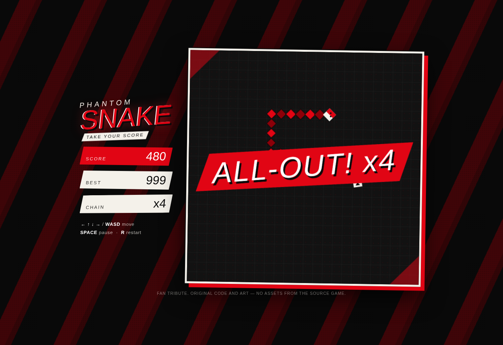

# PHANTOM SNAKE — *Take Your Score*

A browser Snake game dressed in an acid-jazz heist aesthetic: red, black and
off-white, torn-paper panels, hard diagonals, halftone, and an all-out cut-in
every time you steal a calling card.



## Play it

No build step, no dependencies, no server required.

```bash
git clone https://github.com/arukan02/snake-persona-5.git
cd snake-persona-5
xdg-open index.html        # or just double-click it
```

Works offline. Everything is drawn in code.

## Controls

| Input | Action |
|---|---|
| `←` `↑` `↓` `→` or `WASD` | Move |
| `SPACE` | Start, pause, resume |
| `R` | Restart |
| Swipe | Move (touch devices) |

## How it plays

- Each calling card is worth **10 × your chain**.
- Eat the next card within **2.6 seconds** and the chain climbs: `x1 → x8`.
  Dawdle and it drops back to `x1`.
- The snake accelerates with your score — 135 ms per step at zero, down to a
  62 ms floor by 420 points.
- Walls and your own tail end the run. Your best score is kept in
  `localStorage`.

So the scoring rewards the risky line. Playing it safe at `x1` for 400 points
takes far longer than chaining four cards at `x4`.

## What's in here

```
index.html    markup and overlays
style.css     all of the art direction — clip-path panels, stripes, halftone
game.js       grid logic, rendering, effects, synthesised audio
```

Roughly 500 lines total, vanilla JavaScript, canvas 2D. No framework, no
bundler, no fonts or images fetched from anywhere.

Implementation notes worth knowing if you touch it:

- **Input is buffered, not immediate.** Direction presses go into a short queue
  and at most one is applied per step. Without that, two fast taps inside one
  tick can turn the snake back into its own neck.
- **The tail is ignored in collision checks**, because that cell is vacated on
  the same step the head arrives.
- **Audio is synthesised with WebAudio oscillators**, created lazily on the
  first interaction — browsers block audio before a user gesture.
- `window.PhantomSnake` exposes `{ state, start, step, pushDir }` so the game
  can be driven by an automated test harness rather than only by hand.

## Testing

Verified in a real headless Chrome session, not by inspection:

- fresh load, no console errors
- real `ArrowDown` and `a` key events reach the input queue
- a turn is applied, and a 180° reversal is refused
- eating increments score and length; a fast second card raises the chain to
  `x2` and awards 20
- wall collision and self-collision both end the run
- beating the record writes `NEW RECORD` and persists to `localStorage`

## Licence and attribution

This is an **original fan tribute**. No sprites, audio, fonts, logos or any
other assets from the source game are included or downloaded — the visual
language is reinterpreted from scratch in CSS and canvas drawing calls.
Persona 5 is the property of ATLUS / SEGA; this project is unaffiliated with
and unendorsed by them.

Code is released under the MIT licence.
